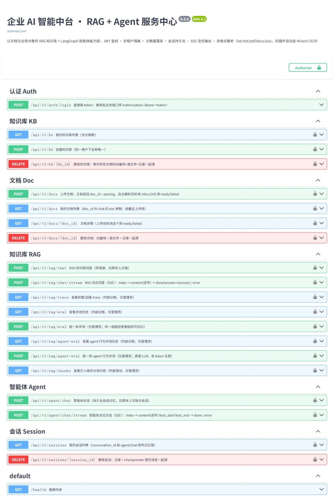
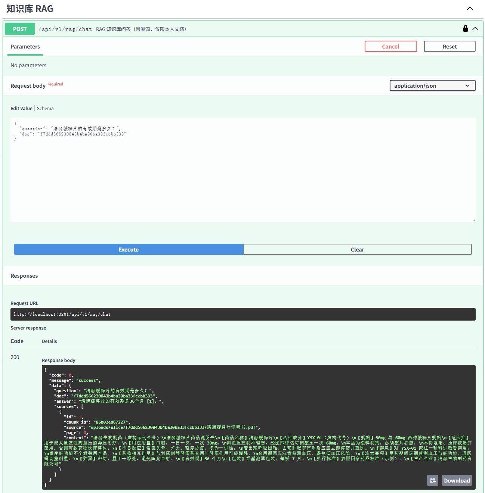
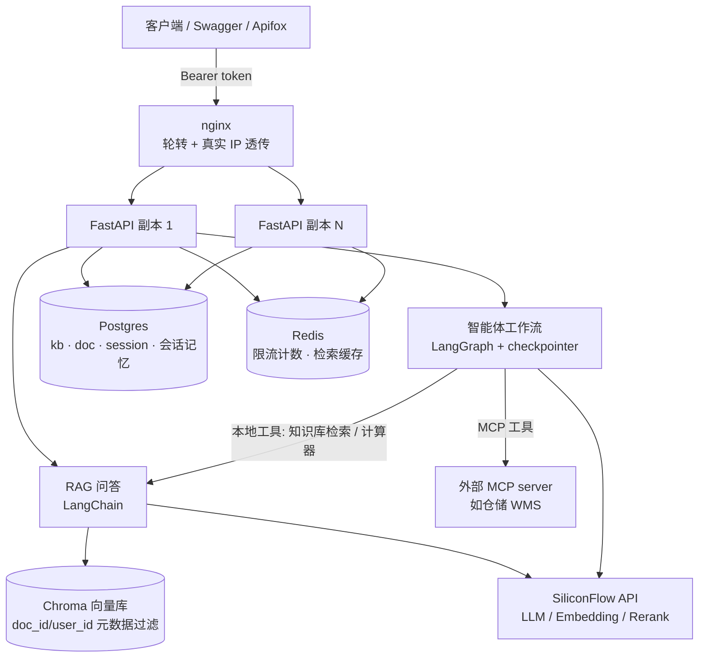

# RAG + Agent 服务中心

> 基于 FastAPI + LangChain/LangGraph 的 RAG 知识库与智能体服务：混合检索、多副本部署、MCP 工具接入、可复现评测。


`FastAPI` · `LangChain / LangGraph` · `Chroma` · `Postgres` · `Redis` · `SiliconFlow`

[快速开始](#快速开始) · [架构](#架构) · [评测](#评测怎么证明有效) · [文档](#文档)

---

## 这是什么

一个以文档为业务对象的 AI 服务：上传文档后，既能做带引用的 RAG 问答，也能让 LangGraph 智能体自主调工具完成任务。

项目重点不在"能跑起来"，而在**生产环境真实会遇到的几件事**——多租户隔离、会话持久化、多副本一致性、评测可复现。所以它有两档部署（零依赖 / 生产栈），并且明确列出**没做和做不了的边界**。

| 能力 | 说明 |
|---|---|
| **检索** | 查询改写 → 向量 + BM25 混合 → RRF 融合 → Rerank 精排 → 带 `[n]` 引用作答 |
| **智能体** | LangGraph ReAct：工具调用、多轮记忆（checkpointer）、超长会话自动压缩 |
| **多租户** | 分块打 `doc_id/user_id/kb_id`，检索按本人文档在 Chroma / BM25 双路收窄 |
| **多副本** | 限流 / 会话记忆 / 向量库 / 缓存全部外置，`--scale app=N` 后请求落到任何副本都正确 |
| **评测** | RAG 检索评测（recall@k / MRR，零 LLM 花费）+ agent 行为评测（真跑 LLM） |
| **可观测** | 每问落 trace，带 token / 工具调用 / 步数记账 |

## 界面

Swagger 全量接口一览（nginx 入口 `:8201`，后面是两个 app 副本）：



RAG 问答：答案带 `[n]` 引用，`sources` 给出编号对应的原文片段：



## 架构



- **RAG 链路**：上传 → 异步解析（load → split → embedding 入库）→ 提问时 **LLM 查询改写 → 混合检索（向量 + BM25）→ Rerank 重排** → LLM 带 `[n]` 溯源引用作答
- **Agent 链路**：LangGraph ReAct 状态机，LLM 决策 → 调工具（知识库检索 / 计算器 / 外部 MCP 工具）→ 再决策 → 输出；`thread_id=会话ID` 走 checkpointer，**服务重启后旧会话记忆仍在**
- **长会话压缩**：历史超过阈值（默认 16 条）时，下一轮把更早对话折成摘要、只留最近 8 条原文，上下文不无限增长
- **多格式解析**：`.txt/.md/.pdf/.docx/.xlsx`，Office/PDF 均带 MIME 内容嗅探；无文字层的扫描/图像 PDF 自动走 MinerU Cloud OCR

## 快速开始

前置：注册 [SiliconFlow](https://cloud.siliconflow.cn) 拿一个 API Key（新用户有免费额度）。扫描件 OCR 可选配 `MINERU_API_KEY`。

```bash
cp .env.example .env      # 填入 SILICONFLOW_API_KEY
python3 -m venv .venv
.venv/bin/pip install -r requirements.txt
.venv/bin/uvicorn app.main:app --reload   # http://localhost:8200/docs
```

**零依赖档**：不启任何中间件，元数据走 SQLite、向量走嵌入式 Chroma、限流在进程内——看功能足够。

**生产栈**：`docker compose up -d postgres redis chroma`，把 `.env` 指过去即可；**多副本**：`docker compose up -d --build --scale app=3`，入口在 `http://localhost:8201`。细节见 [部署与多副本](docs/deployment.md)。

## 演示动线

<details>
<summary>完整 10 步（登录 → 上传 → RAG → Agent → 隔离 → 多副本）</summary>

1. **登录** `POST /auth/login` 拿 `$TOKEN`（alice/alice123）
2. **上传** `POST /docs` 传一份 md/txt → 轮询 `GET /docs/{id}` 到 `ready`
3. **RAG** `POST /rag/chat` 问文档内的问题 → 答案带 `[1]`，`sources` 给出编号 ↔ 原文片段
4. **单文档限定** 库里有多个文档时 `chat` 传 `doc=doc_id` 只在该文档内检索，避免无关分块混入
5. **Agent 计算器** `POST /agent/chat` 问"6*7 等于几" → 验证调 `calculator`
6. **Agent 外部工具** 配了 `MCP_SERVERS_JSON` 后问"批号 QS-2024-9527 在哪个库区" → `tools` 里出现 `get_batch_storage`，答案来自外部系统而非知识库
7. **Agent 多轮记忆** 第 1 次不带 `conversation_id` → 拿到返回 ID；第 2 次带上同一 ID 追问 → 验证会话记忆；`GET /sessions` 可见、删会话清记忆
8. **多租户隔离** 换 bob 登录：`GET /docs` 为空、用 alice 的 doc_id 调 `/rag/chat` 或 `/docs/{id}` → `40002 文档不存在或无权访问`
9. **流式** `curl -N -X POST .../agent/chat/stream` 看 `meta → tool_start → tool_end → content… → done`
10. **多副本** `--scale app=2` 后连打几轮 `agent/chat`：会话记忆在 Postgres，落到哪个副本都答得出；限流计数在 Redis，全局共享（`valkey-cli keys 'rl:*'` 只有一个 key 在涨）

</details>

## 评测（怎么证明有效）

| 评测 | 跑什么 | 成本 | 指标 |
|---|---|---|---|
| RAG 检索 | 17 题 × 9 份合成语料，**只重放检索、不出答案** | 零 LLM 花费 | recall@k / MRR |
| Agent 行为 | 5 条固定任务，**真跑 LLM** | 有花费 | 路由正确率 / 完成率 / 平均步数 / 平均 token |

同一组题改参数重跑即可逐行对比。实测示例：**关 rerank 时 recall@1 = 0.47，开 rerank 后 = 1.0**——调参有据，不靠感觉。

评测会整体绕过检索缓存（`cache.bypass()`）：命中缓存会让分数虚高且不可复现。

## 已知边界

项目明确区分"已实现"和"只是方案"：PostgresSaver 仍是每请求一个连接（未上连接池）、trace / 评测报告仍是 JSONL（多副本轮转有问题）、agent 评测只跑一轮（未做同题多跑波动）、MCP 只验证了自带示例 server。完整清单见 [设计与取舍](docs/design.md)。

## 文档

- [接口一览（含 SSE 事件格式）](docs/api.md)
- [MCP 工具接入（stdio / http、会话开销、切分判据）](docs/mcp.md)
- [部署与多副本（两档部署、鉴权、数据说明、踩坑）](docs/deployment.md)
- [设计与取舍（分布式组件、已知边界）](docs/design.md)

## License

[MIT](LICENSE)
