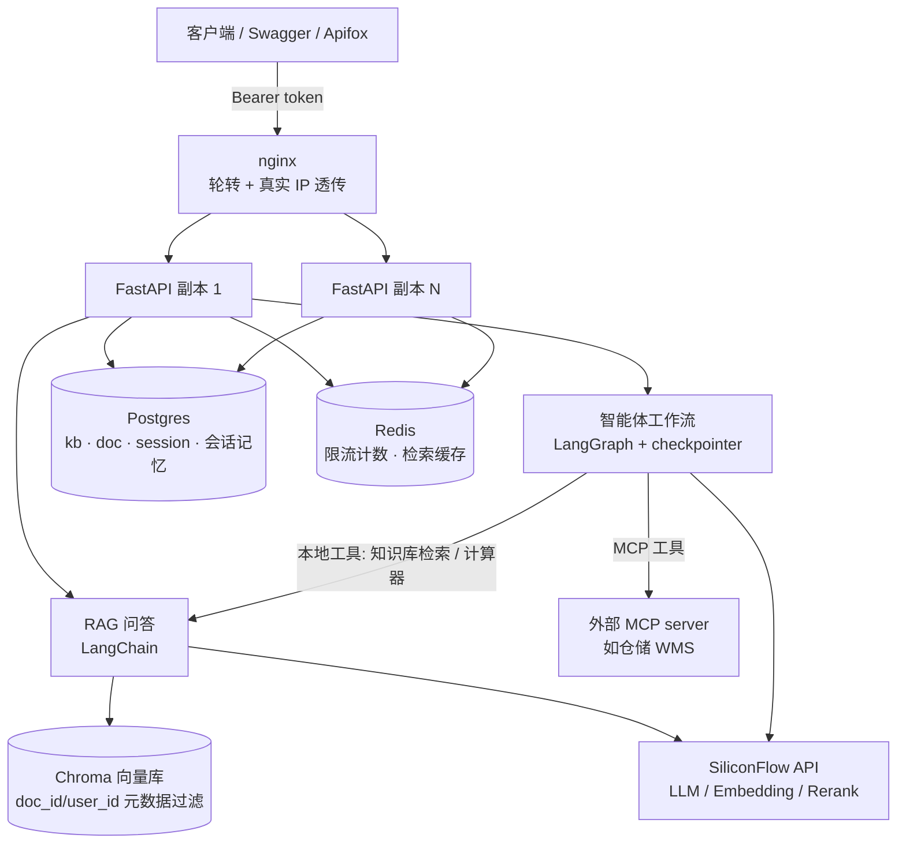

# 企业 AI 智能中台 · RAG + Agent 服务中心

以文档为业务对象的自建 RAG 知识库 + LangGraph 智能体**能力层 / 服务中心**（技术栈：FastAPI + LangChain/LangGraph + Chroma + SiliconFlow）。服务端能力：**JWT 鉴权 · 多租户隔离 · 多格式异步解析（含扫描件 OCR）· 元数据落库 · 会话持久化 · SSE 流式输出 · 评测闭环 · 跨副本限流 · 检索缓存 · 外部 MCP 工具接入**。Swagger / Apifox 直接演示。

模型全部走 SiliconFlow API（一个 key 通吃 LLM / Embedding / Rerank），不部署本地模型。

**依赖分两档**，代码不变、只改配置：

| 档 | 元数据 / 会话记忆 | 限流与缓存 | 向量库 | 适用 |
|---|---|---|---|---|
| 零依赖（默认） | SQLite 文件 | 进程内 | 嵌入式 Chroma（文件） | 本机一键跑、看功能 |
| 生产栈 | Postgres | Redis | Chroma server | `--scale app=N` 多副本 |

> 关系库为什么只有 Postgres、不是 MySQL：会话记忆用的是 LangGraph 官方 checkpointer，**官方只出 sqlite / postgres 两个后端，没有 MySQL saver**。所以生产档选 Postgres，让会话记忆和应用表统一到一个引擎——少一套中间件、能共用连接配置与备份策略。

## 架构



- **RAG 链路**：上传 → 异步解析（load → split → embedding 入库）→ 提问时 **LLM 查询改写 → 混合检索（向量 + BM25）→ Rerank 重排** → LLM 带 `[n]` 溯源引用作答
- **Agent 链路**：LangGraph ReAct 状态机，LLM 决策 → 调工具（知识库检索 / 计算器 / 外部 MCP 工具）→ 再决策 → 输出；`thread_id=会话ID` 走 checkpointer（sqlite 或 Postgres），**服务重启后旧会话记忆仍在**；超长会话自动压缩：历史超过阈值（默认 16 条）时下一轮把更早对话折成摘要、只留最近 8 条原文，上下文不无限增长
- **多格式解析**：`.txt/.md/.pdf/.docx/.xlsx`（Word 走 python-docx、Excel 走 openpyxl、PDF 文字层走 pypdf，Office/PDF 均带 MIME 内容嗅探）；**无文字层的扫描/图像 PDF 自动走 MinerU Cloud OCR**（需 `.env` 配 `MINERU_API_KEY`）
- **多租户隔离**：每个分块打 `doc_id/user_id/kb_id`；所有接口只操作本人资源，检索按本人文档 uuid 列表在 Chroma / BM25 双路收窄。A 用户看不到、删不掉、问不了 B 用户的文档
- **SSE 流式**：`/rag/chat/stream` 与 `/agent/chat/stream` 逐字吐字；Agent 流把模型文本、工具开始/结束分成独立事件
- **多副本**：`docker compose up -d --scale app=N` + nginx 轮转；限流计数在 Redis、会话记忆在 Postgres，所以**请求落到哪个副本都正确**

## 分布式组件怎么起作用

单机版这几个组件都不需要；一旦多副本，它们各自解决一个"进程内状态在多副本下会失效"的问题：

| 组件 | 单副本时的做法 | 多副本为什么不行 | 换成 |
|---|---|---|---|
| 限流 | 进程内计数 dict | N 个副本各自计数，实际上限被放大 N 倍 | Redis `INCR` 全局计数（`app/limiter.py`） |
| 会话记忆 | sqlite checkpointer | 记忆文件在本副本，换副本就"失忆" | Postgres checkpointer（`app/agent/graph.py`） |
| 向量库 | 嵌入式 Chroma 文件 | 进程内独占文件，副本间共享不了 | 独立 Chroma server |
| 检索缓存 | 进程内 / 不缓存 | 缓存命中率被副本数摊薄 | Redis 共享缓存（`app/rag/cache.py`） |

两处**刻意保留降级**、不假装高可用：

- Redis 挂了 → 限流退回进程内计数并打警告：**宁可弱限流（多副本下被放大），也不要因为限流组件故障直接 500**。
- MCP server 连不上 → 不挂载它的工具并告警，agent 用本地工具照常工作；绝不会塞一个"永远返回空"的假工具让模型以为查过了。

## 快速启动

前置：注册 [SiliconFlow](https://cloud.siliconflow.cn) 拿一个 API Key（新用户有免费额度），三种模型默认名见 `.env.example`。上传扫描/图像 PDF 需另配 `MINERU_API_KEY`（[MinerU](https://mineru.net)，可选；不配则扫描件解析失败并提示需配置，文字层 PDF 不受影响）。

```bash
cp .env.example .env      # 填入 SILICONFLOW_API_KEY
python3 -m venv .venv
.venv/bin/pip install -r requirements.txt
.venv/bin/uvicorn app.main:app --reload   # http://localhost:8200/docs
```

上面是**零依赖档**：不启任何中间件，元数据走 SQLite、向量走嵌入式 Chroma 文件、限流限流在进程内 —— 看功能足够了。

### 生产栈（Postgres + Redis + Chroma server）

只多一条命令启基础设施，再用 `.env` 把 app 指过去（连接串示例见 `.env.example`）：

```bash
docker compose up -d postgres redis chroma   # 只起基础设施，app 在本机用 uvicorn 跑
# .env 里打开：DB_URL / CHECKPOINT_BACKEND=postgres / POSTGRES_DSN / REDIS_URL / CHROMA_HOST
.venv/bin/uvicorn app.main:app --reload
```

Docker 全家桶：

```bash
cp .env.example .env
docker compose up -d --build               # 同样打开 /docs
```

### 多副本（水平扩容）

```bash
docker compose up -d --build --scale app=3   # 入口在 nginx：http://localhost:8201
```

`app` 服务不设 `container_name`、不 publish 端口（多副本抢同一宿主端口必然失败），只在集群内 `expose`，对外统一由 nginx 轮转。nginx 用**变量式 `proxy_pass` + `resolver 127.0.0.11 valid=10s`**：否则它只在启动时解析一次服务名并钉死 IP，缩容后会一直往已销毁的副本打。SSE 必须 `proxy_buffering off`，否则事件被攒在缓冲里，"逐字输出"就没了。

> 扩容的前提是上面那几个共享组件都切过去了：限流计数、会话记忆、向量库只要有一个还在进程内，多副本就是错的（见下表）。

## 两种鉴权跑法

业务接口一律要求 `Authorization: Bearer <token>`。`.env` 里 `AUTH_ENABLED` 控制总开关：

| 模式 | 用法 |
|---|---|
| `AUTH_ENABLED=true`（默认，生产形态） | 先 `POST /auth/login` 换 token，之后每个请求带 token |
| `AUTH_ENABLED=false`（本地免登录演示） | 不校验 token，默认以管理员身份直连，只为快速体验 RAG/Agent |

内置演示账号（可在 `.env` 用 `DEMO_USERS_JSON` 覆盖）：`alice/alice123`(user)、`bob/bob123`(user)、`admin/admin123`(admin)。`/rag/eval`、`/rag/agent-eval`、`/rag/trace`、`/rag/chunks` 为内部诊断接口，仅管理员可调。

```bash
# 登录
curl -X POST http://localhost:8200/api/v1/auth/login \
  -H 'Content-Type: application/json' \
  -d '{"username":"alice","password":"alice123"}'
# → data.token

# 上传文档（立刻返回 doc_id + parsing，后台解析完轮询 /docs/{id} 到 ready/failed）
curl -X POST http://localhost:8200/api/v1/docs \
  -H "Authorization: Bearer $TOKEN" \
  -F "file=@演示.md"
```

## 接口

统一响应体 `{"code":0,"message":"success","data":...}`；业务错误用非 0 `code` + HTTP 状态码。

| 方法 | 路径 | 说明 |
|---|---|---|
| POST | /api/v1/auth/login | 登录换 token（body: username/password） |
| POST | /api/v1/kb | 建知识库（同名不重复）；不建则上传自动进「默认知识库」 |
| GET | /api/v1/kb | 我的知识库列表（含文档数） |
| DELETE | /api/v1/kb/{kb_id} | 删知识库：连文档记录 + 向量 + 源文件一起清 |
| POST | /api/v1/docs | 上传文档（multipart `file`，可带 `kb_id` 指定库）：.txt/.md/.pdf/.docx/.xlsx，默认上限 20MB，文件名消毒 + 内容嗅探防路径穿越/二进制冒充 |
| GET | /api/v1/docs | 我的文档列表（可按 `kb_id`/`status` 过滤），doc_id 作 chat 的 `doc` 参数 |
| GET | /api/v1/docs/{doc_id} | 文档详情：上传后轮询这个到 `ready`/`failed`（失败看 `error_msg`） |
| DELETE | /api/v1/docs/{doc_id} | 删文档：向量块 + 源文件 + 记录一起清 |
| POST | /api/v1/rag/chat | RAG 问答（带 `[n]` 溯源，返回 sources）。body: `question`、`doc`（doc_id，限定单文档；留空 = 本人全库） |
| POST | /api/v1/rag/chat/stream | RAG 流式（SSE）：`meta` → `content`(逐字) → `done`(答案+sources)；异常 → `error` |
| POST | /api/v1/agent/chat | 智能体对话（可调工具：知识库检索/计算器/外部 MCP 工具）。body: `question`、`conversation_id`(续传记忆，不带=新会话)、`doc`(限定检索文档) |
| POST | /api/v1/agent/chat/stream | 智能体流式（SSE）：`meta` → 可交错 `tool_start`/`content`/`tool_end` → `done`(答案+tools) |
| GET | /api/v1/sessions | 我的会话列表（conversation_id 给 agent 续传） |
| DELETE | /api/v1/sessions/{session_id} | 删会话：记录 + 会话记忆一起清 |
| POST | /api/v1/rag/eval | 跑 RAG 检索评测（**只重放检索、不出答案**，所以无 LLM 花费）。body: 可传检索参数覆盖 |
| GET | /api/v1/rag/agent-eval | agent 行为评测历史报告（逐轮对比路由正确率/完成率/平均步数/平均 token） |
| POST | /api/v1/rag/agent-eval | 跑一轮 agent 行为评测（**真跑 LLM、有花费**，任务集见 `data/eval/agent_tasks.json`） |
| GET | /health | 健康检查：chunks / auth_enabled / api_key_ready |

### SSE 事件格式

事件之间空行分隔，形如：

```text
event: content
data: {"delta": "试用"}

event: done
data: {"answer":"试用期为六个月 [1]。","sources":[...]}
```

Agent 流额外有 `tool_start`（工具名）与 `tool_end`（工具名 + 结果摘要），便于前端渲染"正在调用 xxx 工具"。

## 外部工具接入（MCP）

知识库只能回答"文档里写过的东西"。而"某批号现在在哪个库区、是否已放行"这类**实时状态不在文档里**，必须调外部系统。MCP 的作用是**协议统一**：不管对端是 WMS、ERP 还是别的系统，agent 侧都走同一套 `读配置 → 握手加载 → 转成工具 → 交给模型` 流程，不用一家写一份适配。

本项目自带一个示例外部系统 `mcp_servers/wms_server.py`（模拟仓储，暴露"查批号库位/状态"），配置一行即可挂进 agent：

```bash
MCP_SERVERS_JSON={"wms":{"command":"python","args":["-m","mcp_servers.wms_server"],"transport":"stdio"}}
```

之后问"批号 QS-2024-9527 在哪个库区"，agent 会自动调 `get_batch_storage` 而不是检索知识库。

### 三种"工具"不是一回事

项目里能被 agent 调用的东西分三种，本质不同：

| | 是谁 | 怎么被调用 | 生命周期 |
|---|---|---|---|
| `calculator` / `search_knowledge_base` | 本项目自己的 Python 函数 | **同进程**直接调用，没有"通信"这回事 | 跟服务同生共死 |
| MCP（stdio） | **独立进程**，扮演外部系统 | 两个进程按 MCP 协议通信（本地管道） | 每次调用拉起一次（见下） |
| MCP（http） | 独立部署的服务，可跨机器 | 按 MCP 协议通信（网络） | server 自己常驻 |

MCP 工具**无论 stdio 还是 http，本质都是"外部系统 + 走协议"**，跟它跑在哪台机器无关。正因为跨了进程边界、要走协议，才会有下面那三个坑（异步桥接、返回形状、冷启动）—— 如果它只是本项目里的一个函数，这些坑一个都不会有。

stdio 与 http 的差别只在"怎么连"：

| | stdio | http |
|---|---|---|
| 跑在哪 | 同机子进程 | 任意机器、常驻服务 |
| 通信 | 本地管道 | 网络 |
| 谁能用 | 本质只有自己 | 多方共用 |
| 鉴权 | 不需要（本地、可信） | 必须加 |
| 部署成本 | 零 | 要部署 + 运维 |
| 工具功能 | **完全一样** | **完全一样** |

最后一行正是 MCP 的价值：同一个 server，换 transport 而已 —— agent 侧代码不用改，只改 `MCP_SERVERS_JSON` 那段配置。

### 开销来自会话模型，不是 stdio

`langchain-mcp-adapters` 默认**每次工具调用新建一个会话**（`MultiServerMCPClient.get_tools()` 文档原话：*"starting a new session on each tool call"*）。所以每次调用都是：起子进程 → 握手 → 干活 → 销毁，这就是那 ~1.5s 的来源。

两个现象别混为一谈：

| 现象 | 根源 | 治法 |
|---|---|---|
| 每次调用 ~1.5s | **每次新建会话** | 显式持长会话（`client.session(name)`）复用，**不改传输方式也能治** |
| 只能同机、不能多方共享 | **stdio 传输方式本身** | 只能改 http |

还有个容易搞错的点：**进程数跟"工具个数"无关**。一个 server 暴露 N 个工具仍共用一条 transport、一个进程；开销按 **server 个数（加载时）+ 工具调用次数（运行时）** 算，不是 × 工具数。

### 怎么切 MCP server：看边界，不看个数

| 判据 | 该拆 |
|---|---|
| 依赖冲突 | 要互相打架的库版本（`pandas 1.x` vs `2.x`）—— 同进程装不下 |
| 依赖重量 | 一方要 import 大库（如 torch）、一方是纯计算；混在一起 → 调轻工具也得付重的冷启动 |
| 网络域 | 一个连内网 ERP、一个连公网 API —— 网络策略不同 |
| 权限边界 | 只读 vs 能写库/能花钱 —— 一个进程的凭证 = 它能干的**全部**事 |
| 归属 | 不同团队维护的系统（WMS 团队出 wms server、ERP 团队出 erp server） |
| 故障隔离 | 一个崩了不该拖垮另一个 |

反过来说：**同一系统的同一批数据、零重依赖、同一权限**就该合 —— 拆开只白增配置、握手次数和进程数。

本项目的 `wms_server.py` 两个工具（`get_batch_storage` / `list_batches`）四条全指向"合"（同一批假数据、都只读、同属"仓库"），所以一个 server 装两个工具是**边界本来如此**，不是硬塞。惯例是 **一个 server ≈ 一个外部系统**。

> 依赖越重，越不能忍"每次调用起一次"：重依赖的 server 要么显式持长会话、要么常驻 http，别让它跟着调用反复冷启动。

接入时要处理的三个真实问题（都在 `app/agent/mcp_tools.py` 里）：

1. **工具是 async-only**：适配器把 MCP 工具实现成协程，同步 `invoke` 直接 `NotImplementedError`。而 `/agent/chat` 是同步路由、跑在线程池里（那个线程没有事件循环），所以补了一个常驻事件循环线程做桥接 —— 只为一个工具把整条同步链路（压缩、fallback 重放、usage 记账）改成 async 不划算。
2. **返回形状**：MCP 返回的是内容块列表 `[{type,text}]`，直接塞给模型是它的 repr。统一拍平成纯文本，同步/异步两条路径返回一致。
3. **冷启动**：默认的"每次调用新建会话"导致每次调用都拉起一次 server 子进程（实测单次约 1.5s），首次加载握手约 7s。已在服务启动时**后台线程预热**把握手做掉，不让第一个用户请求替整个进程付这笔延迟。

诚实边界：**没接入真实第三方 MCP server**，验证用的是项目自带的示例 server。另外注意上一节的因果 —— "每次调用起子进程"的根源是**会话模型**（默认每次调用新建会话），**不是 stdio 本身**：显式持长会话即可消掉，不改传输方式也行；stdio 真正解不掉的是"只能同机、不能多方共享"。agent 行为评测的任务集（`agent_tasks.json`）也**不含 MCP 任务**，MCP 路由是靠前面那条手工问答验证的，没有进评测分数。

## 演示动线

1. **登录** `POST /auth/login` 拿 `$TOKEN`（alice/alice123）
2. **上传** `POST /docs` 传一份 md/txt → 轮询 `GET /docs/{id}` 到 `ready`
3. **RAG** `POST /rag/chat` 问文档内的问题 → 答案带 `[1]`，`sources` 给出编号 ↔ 原文片段
4. **单文档限定** 库里有多个文档时 `chat` 传 `doc=doc_id` 只在该文档内检索，避免无关分块混入
5. **Agent 计算器** `POST /agent/chat` 问"6*7 等于几" → 验证调 calculator
6. **Agent 外部工具** 配了 `MCP_SERVERS_JSON` 后问"批号 QS-2024-9527 在哪个库区" → `tools` 里出现 `get_batch_storage`，答案来自外部系统而非知识库
7. **Agent 多轮记忆** 第 1 次不带 `conversation_id` → 拿到返回 ID；第 2 次带上同一 ID 追问 → 验证会话记忆；`GET /sessions` 可见、删会话清记忆
8. **多租户隔离** 换 bob 登录：`GET /docs` 为空、用 alice 的 doc_id 调 `/rag/chat` 或 `/docs/{id}` → `40002 文档不存在或无权访问`
9. **流式** `curl -N -X POST .../agent/chat/stream` 看 `meta → tool_start → tool_end → content… → done`
10. **多副本** `--scale app=2` 后连打几轮 `agent/chat`：会话记忆在 Postgres，落到哪个副本都答得出；限流计数在 Redis，全局共享（`valkey-cli keys 'rl:*'` 只有一个 key 在涨）

## 数据说明

- `data/`（SQLite + Chroma + eval 报告）、`uploads/`（源文件）默认被 `.gitignore` 忽略，新 clone 需自行上传文档建库
- 评测黄金问题集在 `data/eval/golden.json`，`POST /rag/eval` 只重放检索、不出答案；同一组题改参重跑后 `GET /rag/eval` 逐行对比分数（recall@k / MRR），归因到参数而非生成波动
- agent 行为评测任务集在 `data/eval/agent_tasks.json`（路由正确 / 该不该调工具 / 答案是否达标），报告落 `agent_reports.jsonl`。与 RAG 评测最大的不同：**它会真跑 LLM、有花费**，所以只放 5 条固定任务
- 评测跑的时候会**整体绕过检索缓存**（`cache.bypass()`）：命中缓存会让分数虚高且不可复现，评测必须打真链路
- `data/trace/trace.jsonl` 每问一条 answer 记录，带 `usage` 字段（`model_calls`/`tool_calls`/`prompt_tokens`/`completion_tokens`/`total_tokens`）——每 run LLM 消耗记账，`GET /rag/trace`（管理员）可查
- 元数据 schema 变更后旧向量块会不可见（无 user 归属标签），demo 语料可整体重建后再跑评测

### 两处容易踩的坑

- **`data/chroma`（嵌入式）与 `data/chroma-server`（独立 server）是两份数据，会各自漂移**。切部署形态时不会自动同步，换过去要自己拷一次目录（或重新上传建库）。
- **`data/trace/trace.jsonl` 是追加写文件**：多副本下 N 个副本写同一个挂载卷，行不会交错损坏（单次 write 追加），但**轮转（按行数截尾）在多副本下会互相踩**。生产多副本应把 trace 落到数据库或每副本独立文件，本项目未改。

## 已知取舍（没做 / 做不了的）

| 项 | 现状 |
|---|---|
| PostgresSaver 连接 | 每请求开一个连接（`from_conn_string`），高并发应换 `psycopg_pool` 连接池 |
| trace / eval 报告 | 仍是 JSONL 文件，多副本下有上面的轮转问题 |
| agent 评测稳定性 | 只跑一轮看指标，**"同题多跑 N 次看波动"没做**（成本×N） |
| MCP | 只验证了项目自带的示例 server，未接真实第三方；stdio 每次调用起子进程（约 1.5s） |
| 限流降级 | Redis 挂 → 退回进程内计数，多副本下等于限流被放大 N 倍（选择"弱限流"而不是"直接 500"） |
| K8s | 未做，docker compose + nginx 已够本项目规模 |
