# Agent Harness 层

> 定位：**最小生产级 Agent Harness**，不是完整 Harness 平台。  
> 目标是验证 Agent 运行时在真实约束下能不能稳：工具怎么注册、记忆怎么持久化、循环怎么停、失败怎么兜、评测怎么做、扩容后状态怎么共享。不是堆功能。

## 1. 它由什么组成

```mermaid
flowchart TD
  U[请求] --> API[FastAPI /agent/chat]
  API --> H[Agent Harness]
  H --> L[ReAct Loop<br/>LangGraph create_react_agent]
  L --> T[工具层<br/>知识库检索 / 计算器 / MCP]
  L --> M[记忆层<br/>checkpointer + thread_id]
  L --> G[护栏<br/>步数闸 / 工具防重 / 超时 / fallback]
  H --> O[可观测<br/>trace_id / span / usage / JSONL]
  O --> E[评测 /eval/*]
```

| 能力 | 实现 | 失败语义 / 契约 |
|---|---|---|
| Agent 循环 | LangGraph `create_react_agent` | `recursion_limit` 兜底熔断；模型输出最终答案才停 |
| 运行熔断 | `pre_model_hook` 读本轮消息 | 业务口径四道硬上限：工具轮数 / 连续相同调用 / 耗时 / token；超限抛 `AgentRunLimitError`，返回 429，不触发 fallback |
| 上下文预算 | `pre_model_hook` + 工具结果外置 | 超长工具结果原文落盘后截断；本轮总量仍超预算时压缩更早结果（最近 N 条保留）；只改正文，不破 tool_call 配对 |
| 执行幂等 | 危险工具执行台账（SQLite） | 执行前按 `conversation_id + tool_call_id` 落账；崩溃/重放不再重复执行（at-most-once，宁可漏执行等人工复核） |
| 人工审批（HITL） | `post_model_hook` + `interrupt()` | 模型产出 tool_calls 后、执行前暂停；`/agent/approve` 批准/拒绝/改参数后从 checkpoint 续跑；超时/缺失审批 fail-closed；决策落审计日志。**超时惰性兜底**：挂起超过 `AGENT_APPROVAL_TIMEOUT` 秒后，下一次问新问题或审批会自动按拒绝恢复；挂起本身不占连接，只在 checkpointer 里留状态 |
| 工具注册 | LangChain `@tool` + MCP | 工具名/描述/参数给模型；检索工具按请求闭包绑定文档范围 |
| 工具防重 | 检索工具内 `seen` dict | 同一轮重复 query 复用上次结果；计算器故意不做（纯函数、零副作用） |
| 记忆 | LangGraph checkpointer | `thread_id=conversation_id`；sqlite 本地 / Postgres 多副本；超长会话压缩；也是 HITL 暂停/恢复的载体 |
| 失败兜底 | 主/备 LLM、超时、降级 | 主供应商失败可切 backup；护栏/审批不是供应商故障，不参与 fallback；MCP 工具失败不伪造答案 |
| 可观测 | trace_id + 逐阶段 span + usage + JSONL + `/metrics` | 解析/检索/生成/工具/Agent 各阶段耗时；每问记模型调用/工具调用/token/步数；`GET /rag/trace`；Prometheus 请求计数/延迟/uptime |
| 评测 | `/api/v1/eval/*` | 检索 61 题、生成 12 正 + 8 负、Agent 8 任务；三层都 bypass 缓存 |
| 多副本 | Redis + Postgres + 独立 Chroma | 限流/记忆/向量库/缓存外置，换副本状态不丢 |

## 2. 生产级判断标准

企业级 Harness 不是“功能多”，而是下面五件事有没有落地：

1. **契约清楚**：工具、记忆后端、模型供应商、评测集都有明确接口和替换点；
2. **失败语义完整**：循环能停、工具失败有兜底、主模型挂了能切、超时会标记失败；
3. **可评测**：固定题集 + 指标 + 回归门禁，不靠“感觉”；
4. **可运维**：healthcheck、非 root 容器、多副本状态外置、日志/usage；
5. **边界诚实**：没做的写清楚，不把方案说成已实现。

这五项在这个项目里都有对应实现。项目规模不大，但每一项都有失败路径，不是只跑 happy path。

## 3. 扩展点：往企业级走要加什么

| 扩展点 | 现在 | 怎么加 |
|---|---|---|
| 新工具 | `@tool` 或 MCP 配置 | 加工具函数/加 server 配置，agent 代码不动 |
| 新记忆后端 | sqlite / Postgres | 实现 checkpointer 工厂，换配置 |
| 新模型供应商 | primary/backup | 在 `providers.py` 加适配，fallback 复用 |
| 新护栏 | 业务熔断 4 道 + 防重 + 超时 | 改 pre_model_hook 或工具层包装；阈值走配置 |
| 新评测 | 三层固定集 | 加数据集 + runner + `/eval` 路由 |
| 沙箱 | 无 | 把工具执行放容器/microVM；当前工具是可信代码 |
| 子智能体路由 | 无 | LangGraph 子图 + router 节点；本项目未接 |
| Skills 市场 | 无 | 工具注册中心 + 版本/权限/上架流程 |
| Human-in-the-loop | 工具级审批：外部/未知工具执行前暂停，`/agent/approve` 续跑（超时 fail-closed、审计落库） | 平台级审批流（多人会签、审批中心对接）未做；本地只读工具自动放行 |
| 定时调度 | 无 | cron/调度器接入；本项目未接 |
| Metrics/告警 | 有 `/metrics` + Prometheus/Grafana 配置 | 已提供抓取/告警/看板；未在真实集群验证 |
| K8s | Helm 清单已提供 | `deploy/helm/rag-agent-service`；未在真实集群验证；compose + nginx 仍是主部署方式 |

## 4. 边界与扩展

本项目是**个人服务层技术验证**，不覆盖平台层：多租户平台管理、工作流画布、Skills 市场、沙箱、子智能体编排不在范围。HITL 只做了工具级审批（暂停/批准/拒绝/改参），平台级审批流（会签、审批中心、超时升级）不做。

上下文治理的边界也要说清：harness 做的是"单轮工具结果预算 + 外置"，**长报告分段生成属于业务层**（大纲 → 分节生成 → 每节落库 → 下一节只带大纲和摘要），不在这个 repo 里；checkpoint 只保证可恢复，不减少再次喂给模型的上下文。执行台账按 `tool_call_id` 做 at-most-once，**跨系统的端到端幂等**仍需下游支持幂等键。

## 5. 一句话

> 这是一个最小生产级 Agent Harness：ReAct 循环、工具注册、checkpointer 记忆、四道业务熔断 + 工具防重 + 超时/fallback、工具级人工审批（HITL）、MCP、trace/usage、多副本；平台层能力不在本项目范围。
