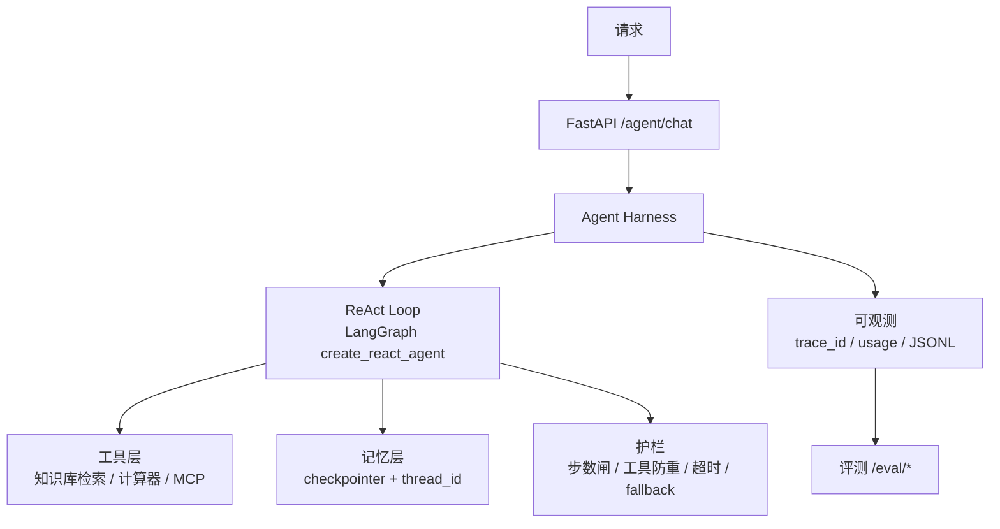

# Agent Harness 层

> 定位：**最小生产级 Agent Harness**，不是完整 Harness 平台。  
> 目标是验证 Agent 运行时在真实约束下能不能稳：工具怎么注册、记忆怎么持久化、循环怎么停、失败怎么兜、评测怎么做、扩容后状态怎么共享。不是堆功能。

## 1. 它由什么组成

| 能力 | 实现 | 失败语义 / 契约 |
|---|---|---|
| Agent 循环 | LangGraph `create_react_agent` | `recursion_limit` 熔断；模型输出最终答案才停 |
| 工具注册 | LangChain `@tool` + MCP | 工具名/描述/参数给模型；检索工具按请求闭包绑定文档范围 |
| 工具防重 | 检索工具内 `seen` dict | 同一轮重复 query 复用上次结果；计算器故意不做（纯函数、零副作用） |
| 记忆 | LangGraph checkpointer | `thread_id=conversation_id`；sqlite 本地 / Postgres 多副本；超长会话压缩 |
| 失败兜底 | 主/备 LLM、超时、降级 | 主供应商失败可切 backup；MCP 工具失败不伪造答案 |
| 可观测 | trace_id + usage + JSONL + `/metrics` | 每问记模型调用/工具调用/token/步数；`GET /rag/trace`；Prometheus 请求计数/延迟/uptime |
| 评测 | `/api/v1/eval/*` | 检索 61 题、生成 12 正 + 8 负、Agent 5 任务；三层都 bypass 缓存 |
| 多副本 | Redis + Postgres + 独立 Chroma | 限流/记忆/向量库/缓存外置，换副本状态不丢 |

## 2. 生产级判断标准

企业级 Harness 不是“功能多”，而是下面五件事有没有落地：

1. **契约清楚**：工具、记忆后端、模型供应商、评测集都有明确接口和替换点；
2. **失败语义完整**：循环能停、工具失败有兜底、主模型挂了能切、超时会标记失败；
3. **可评测**：固定题集 + 指标 + 回归门禁，不靠“感觉”；
4. **可运维**：healthcheck、非 root 容器、多副本状态外置、日志/usage；
5. **边界诚实**：没做的写清楚，不把方案说成已实现。

这五项在这个项目里都有对应实现。项目规模不大，但每一项都有失败路径，不是只跑 happy path。

## 3. 扩展点：往企业级走要加什么

| 扩展点 | 现在 | 怎么加 |
|---|---|---|
| 新工具 | `@tool` 或 MCP 配置 | 加工具函数/加 server 配置，agent 代码不动 |
| 新记忆后端 | sqlite / Postgres | 实现 checkpointer 工厂，换配置 |
| 新模型供应商 | primary/backup | 在 `providers.py` 加适配，fallback 复用 |
| 新护栏 | recursion_limit / 防重 / 超时 | 在 agent 调用或工具层包一层 |
| 新评测 | 三层固定集 | 加数据集 + runner + `/eval` 路由 |
| 沙箱 | 无 | 把工具执行放容器/microVM；当前工具是可信代码 |
| 子智能体路由 | 无 | LangGraph 子图 + router 节点；公司 Bisheng 平台已有 |
| Skills 市场 | 无 | 工具注册中心 + 版本/权限/上架流程 |
| Human-in-the-loop | 无 | LangGraph `interrupt` + 审批接口 |
| 定时调度 | 无 | 公司 Bisheng 有定时任务；demo 未接 |
| Metrics/告警 | 无 Prometheus | 加 `/metrics` 计数/延迟，接告警规则 |
| K8s | 无 | compose + nginx 已够本项目规模 |

## 4. 和公司 Bisheng 的关系

公司 Bisheng 定制分支里有更完整的 Harness/子智能体、纳管智能体、定时任务能力，那是平台层。  
我的角色是 AI 工具子模块 + 评测监控：理解 Harness 的调度/工具/记忆/护栏机制，把业务工具接进去，并用三层评测证明它有效。  
**不把平台层说成个人产出，也不把 demo 说成完整平台。**

## 5. 面试一句话

> 有 Harness 层，但要分清平台和 demo：公司 Bisheng 有完整 Harness/子智能体/纳管/定时任务，平台团队在做；我负责 AI 工具和评测监控。我自己按生产级思路做了最小 Harness：ReAct 循环、工具注册、checkpointer 记忆、步数闸/工具防重/超时/fallback、MCP、trace/usage、多副本。没有沙箱、子智能体编排、Skills 市场、HITL——这些是边界，不是遗漏。
